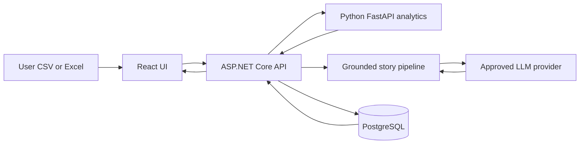
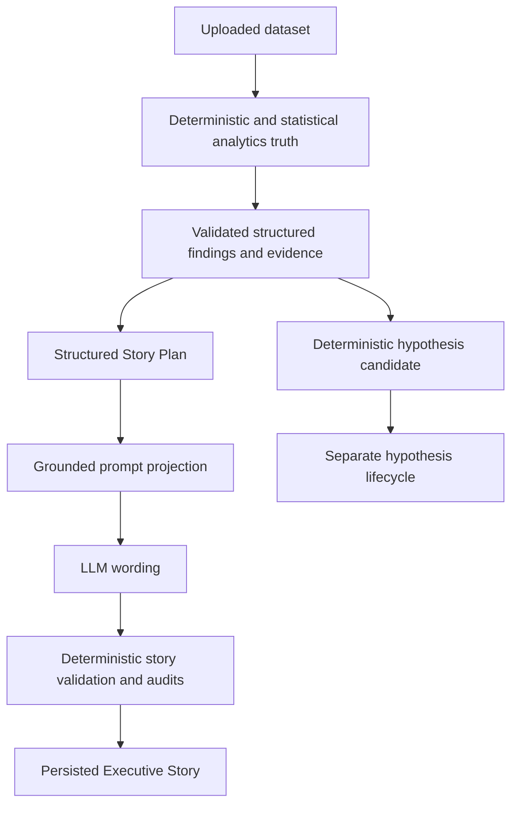
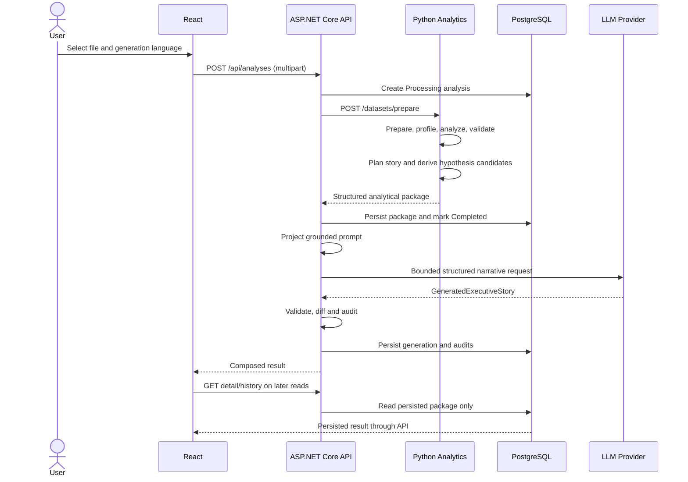

# Data Story Builder Architecture

This document describes the implemented decomposition, responsibility and trust boundaries of the 2026 internship MVP. Setup and command details remain in the [README](../README.md); architectural decisions are recorded in [ADRs](adr/README.md).

## System context



The locked logical pipeline is:

```text
User Excel/CSV
→ React UI
→ ASP.NET Core API
→ Data Ingestion / Preparation
→ Data Profiler
→ Metric/Data Integrity
→ Insight Engine
→ Relationship Engine
→ Business Relevance
→ Insight Integrity
→ Causality Guard
→ Missing Context
→ Story Planner
→ LLM
→ Story Generator
→ Story Auditor
→ Executive Story
→ Hypothesis Tracker
→ PostgreSQL
```

This is a logical responsibility chain. In the implementation, deterministic hypothesis candidates are created by Python alongside the structured story plan and persisted with the analytical package before .NET invokes story generation. PostgreSQL persists both that package and the later generation/audit result.

## Responsibility boundaries

### React presentation layer

React owns file selection/upload, truthful loading/error/empty states, Overview, charts, Insight Explorer, Why This Insight?, Executive Story, Story Audit, Hypotheses, History, Turkish/English presentation, responsive behavior, and light/dark themes.

React does **not** generate analytical truth. It maps and displays backend read contracts; it does not rediscover insights, compute business metrics, assign confidence/importance, infer causality, or translate persisted generated prose.

### ASP.NET Core application boundary

The API owns the HTTP contract and analysis lifecycle, validates uploads and requested story language, calls the analytics service, coordinates PostgreSQL transactions, projects grounded prompt input, invokes the configured provider through `ILlmClient`, validates and audits generated stories, persists story results, exposes History/detail reads, and enforces hypothesis lifecycle transitions.

### Python analytics boundary

Python/FastAPI owns ingestion and preparation, profiling and data quality, metric integrity, deterministic/statistical CHANGE, TREND, ANOMALY, CONTRIBUTION and CONTRAST insights, scoring, relationships, business relevance, insight integrity, causality guard, missing context, overview chart data, structured story planning, and deterministic hypothesis-candidate generation.

Python returns a structured analytical result. It does not generate executive prose.

### PostgreSQL persistence boundary

PostgreSQL stores the analysis lifecycle and analytical result package: profile/preparation results, insights and evidence, relationships/ranking, integrity, causality, missing context, structured story plan, generation metadata, generated story, numerical/full audits, and hypotheses with lifecycle reasons. It backs History, reload, and detail reads.

PostgreSQL is **not a raw uploaded-row warehouse** in this MVP.

## Trust and truth hierarchy



Numerical truth originates in deterministic/statistical analytics. Generated text is never trusted merely because a provider returned it. Every generated item must retain a `SourceItemId` that traces it to a permitted story-plan item and its evidence. A hypothesis is epistemically separate from a fact or insight and cannot rewrite either.

## End-to-end analysis flow



The concrete sequence is:

1. React uploads a supported file and requested generation language.
2. .NET creates a `Processing` analysis lifecycle record.
3. Python ingests, prepares and profiles the data.
4. Deterministic/statistical insights and evidence are generated.
5. Relationships, relevance, integrity, causality and missing context are evaluated.
6. Python creates the `StructuredStoryPlan` and deterministic hypothesis candidates.
7. .NET persists the analytical package transactionally and marks the analysis `Completed`.
8. .NET projects `GroundedStoryPromptInput` from the returned validated package.
9. The provider produces a structured narrative.
10. .NET validates structure/source IDs and performs numerical, semantic, coverage, causal and framing audits.
11. The generated story, generation state and audits are persisted separately.
12. React reads the persisted result through detail and History contracts.

There are no asynchronous workers, message queues, event buses, or streaming stages.

## Story pipeline

```text
StructuredStoryPlan
→ GroundedStoryPromptInput
→ GroundedPromptBuilder
→ LLM
→ GeneratedExecutiveStory
→ GeneratedStorySafetyValidator
→ Story/Data Diff
→ Evidence Coverage and Numerical Audit
→ Semantic Safety
→ Narrative Framing/Bias
→ FullStoryAuditor
→ persisted story and audit result
```

`GroundedStoryPromptProjector` limits the provider input to plan-selected items, authoritative evidence, qualification requirements, causal constraints and missing-context limitations. Each story item carries its planner `SourceItemId`. Structural validation rejects unknown, misplaced, duplicate or omitted identifiers; later auditors use the same identifier to compare wording and numbers with authoritative evidence for that item.

Golden Truth is never runtime prompt input. It is a test-only oracle.

The current policy can make at most one deliberate regeneration attempt for eligible audit failures. This remains part of the same user-requested new analysis; persisted reads never regenerate.

## Causality architecture

Association or correlation is not causation. `CO_MOVES_WITH` is an observational relationship, not a causal edge. For example, simultaneous `MarketingSpend +20%` and `Revenue +30%` may be described as moving alongside one another, but not as “MarketingSpend caused Revenue growth” unless causality is established.

The controlled scenario is `CAUSALITY_NOT_ESTABLISHED`. The Causality Guard supplies allowed and forbidden concepts to planning and audit stages. Missing Context records unavailable variables—such as competitor or pricing context—that limit interpretation. Semantic safety blocks unsupported causal wording rather than weakening the underlying evidence contract.

## Hypothesis architecture

```text
Validated signals + relationships + causality guard
+ evidence + counter-evidence + missing context
→ deterministic hypothesis candidate
```

The LLM does not discover hypotheses. Python creates candidates deterministically, including confidence, source insight/relationship links, counter-evidence and missing context. Hypotheses use explicit states: `OPEN`, `SUPPORTED`, `CONFIRMED`, and `REJECTED`.

The backend lifecycle endpoint permits only constrained transitions and requires/persists transition reasons. A state change updates the hypothesis record; it does not rewrite source facts, insights, relationships, story text, or historical audit output.

## Persistence and historical reads

- An analysis is created as `Processing` and becomes `Completed` after the analytical package commits, or `Failed` when pre-completion processing fails.
- Provider/generation failure is persisted as a structured story-generation failure for an otherwise completed analysis.
- Story plan, generated story, audits, hypotheses, and generation language are persisted.
- `GET /api/analyses`, `GET /api/analyses/{id}`, refresh restoration, and History switching read PostgreSQL only.
- Reading an older analysis does not rerun analytics, generation, audits, or hypothesis discovery.
- Historical audit artifacts are read as persisted; viewing them does not recompute or mutate them.

This document does not claim append-only database semantics. The explicit hypothesis status endpoint is a controlled persisted mutation.

## Failure and safety boundaries

Failures are surfaced as controlled application outcomes rather than fabricated results:

- malformed, empty, oversized or unsupported files produce controlled client errors;
- analytically insufficient valid data produces a controlled analytics/client response (including 422 where applicable);
- analytics unavailability marks the pre-completion lifecycle failed where possible;
- unavailable/misconfigured providers persist a structured generation failure rather than a fake story;
- unknown or missing `SourceItemId` fails story safety validation;
- unsupported numerical tokens, semantic distortion, causal overstatement, or required-context omission fail/block the applicable audit;
- invalid hypothesis transitions return a controlled 4xx response.

## Why This Insight? explainability surface

Where the backend result provides them, the frontend traces: what happened; previous/current values; absolute/relative change; evidence; calculation; importance; confidence; relationships; business relevance; counter-evidence; integrity; causality; and missing context.

This is an architectural inspection surface over backend analytical truth. React formats values for presentation but does not analytically recompute them.

## Golden Truth boundary

```text
Controlled demo scenario
→ tests/golden/expected_results.json
→ deterministic regression tests
```

Golden Truth verifies expected analytics and safety behavior. It is not production truth storage, frontend demo data, runtime configuration, or LLM input.

## Security and privacy boundary

- The provider receives grounded structured story input, not the raw uploaded dataset.
- provider and database secrets are externalized from committed configuration;
- a persisted raw-row warehouse is intentionally absent;
- provider failure cannot silently fabricate a story;
- logs and failures should identify stages without exposing uploaded business data or secrets.

These controls describe prototype boundaries and do not assert regulatory certification or compliance.

## Architectural non-goals

The MVP intentionally excludes microservice expansion, streaming pipelines, event buses, enterprise authentication, multi-user authorization, ERP/Teams/Outlook/Power BI integrations, a raw data warehouse, advanced causal AI, unnecessary Clean Architecture layers, and a second semantic LLM auditor. These are explicit scope controls, not undocumented missing features.

## Decision index

- [ADR-001: LLM is not the analytics engine](adr/001-llm-is-not-the-analytics-engine.md)
- [ADR-002: Python analytics and ASP.NET Core orchestration split](adr/002-python-analytics-dotnet-orchestration.md)
- [ADR-003: Story Planner before LLM and Story Auditor after LLM](adr/003-bounded-story-generation.md)
- [ADR-004: Deterministic Causality Guard](adr/004-deterministic-causality-guard.md)
- [ADR-005: Persist validated analytical packages, not a raw warehouse](adr/005-persist-analytical-package.md)
- [ADR-006: Separate facts, insights, and hypotheses](adr/006-fact-insight-hypothesis-separation.md)
- [ADR-007: Golden Truth controlled scenario](adr/007-golden-truth-verification.md)
- [ADR-008: Deterministic story safety instead of a second LLM](adr/008-deterministic-story-safety.md)
